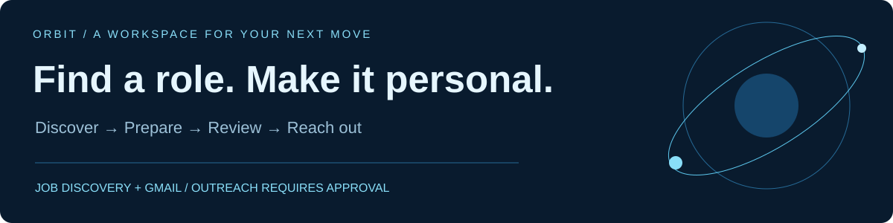
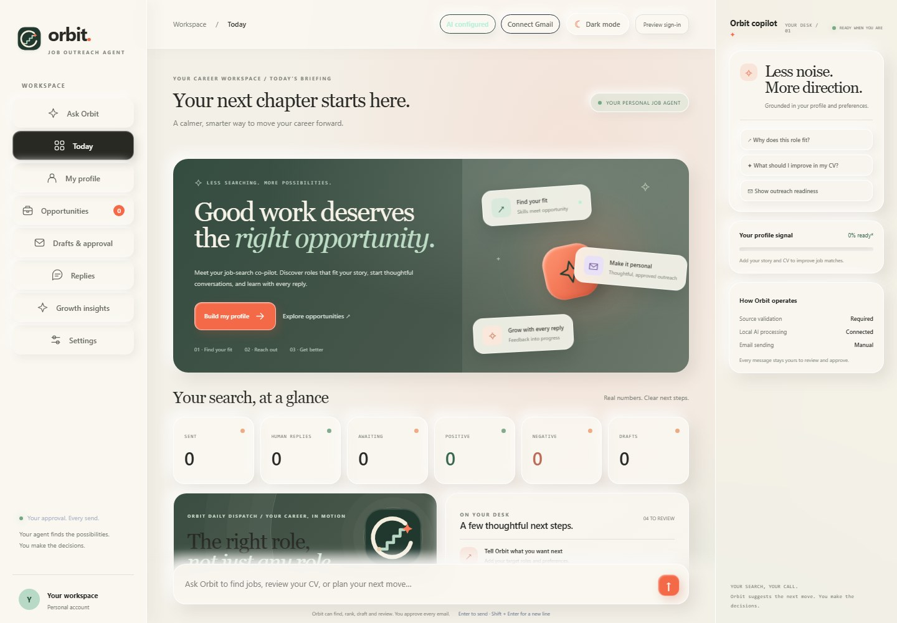
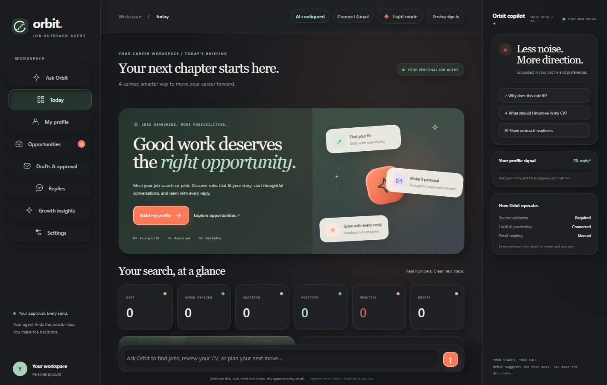

<h1 align="center">Orbit</h1>
<p align="center"><strong>Your career search, with more intention.</strong><br>Discover opportunities, prepare thoughtful outreach, and keep every decision yours.</p>
<p align="center"><a href="https://orbit-job-agent.onrender.com/"><strong>Open the live Orbit preview ↗</strong></a> · Invitation required · <a href="LICENSE">MIT license</a></p>

Orbit is a private job-search workspace with a conversational command bar. Bring your CV, resume, and portfolio into one place; review relevant roles; prepare Gmail drafts; and learn from employer replies. Orbit keeps outreach under your control: **it never sends a message until you approve that exact draft.**

<p align="center"></p>
<p align="center"><sub>Current interface captured from this repository's source using a fresh local workspace. Example counters are empty by design.</sub></p>

<details>
<summary>See the dark theme and lamp sign-in experience</summary>

<p></p>
<p></p>

</details>

## Find your way around

- [How Orbit works](#how-orbit-works)
- [What you can do](#what-you-can-do)
- [Run Orbit locally](#run-orbit-locally)
- [Choose an AI setup](#choose-an-ai-setup)
- [Connect Gmail safely](#connect-gmail-safely)
- [Hosted preview and deployment](#hosted-preview-and-deployment)
- [Privacy, safety, and limitations](#privacy-safety-and-limitations)
- [Development and verification](#development-and-verification)

## How Orbit works


The prompt bar can take plain-language requests or direct commands. Orbit turns supported requests into reviewable work, then shows what it did, what needs your attention, and what remains incomplete. Actions that contact employers stay behind explicit review steps.

## What you can do

| Area | What Orbit helps with |
| --- | --- |
| **Your story** | Save career goals and preferences; import TXT, Markdown, DOCX, or selectable-text PDF materials. |
| **Opportunity discovery** | Find roles from supported sources, add a listing yourself, compare evidence against your profile, sort matches, and review gaps. |
| **Daily routine** | Set discovery time, time zone, result volume, and whether scheduled searches are enabled. The app must be awake for local schedules; free hosting schedules are best effort. |
| **Thoughtful outreach** | Confirm the published contact and source, create a Gmail draft, attach chosen materials, and review its final wording. Editing a draft clears its approval. |
| **Reply tracking** | Review tracked responses, distinguish human replies from automatic messages and bounces, and correct a classification when needed. Silence stays “awaiting”—it is not treated as a rejection. |
| **Career growth** | Review suggestions grounded in your materials, role requirements, and available employer feedback. Treat AI-generated advice as a starting point to verify. |
| **Conversation and history** | Ask Orbit to carry out supported tasks, revisit saved conversations, and inspect receipts for completed or failed actions. |

<details>
<summary>Try a few prompts</summary>

```text
Find relevant jobs for my profile
Rank my saved jobs by fit
Review my resume for this role
Show my outreach stats
Check my tracked replies
Pause daily discovery
```

Orbit also supports direct controls for common tasks, so simple requests do not need an AI planning call. The planner cannot send email, approve a draft, change credentials, or execute shell commands.

</details>

## Run Orbit locally

### Requirements

- Node.js 24 or newer
- Gmail and an AI provider are optional; they are configured separately when you need those features

```sh
git clone https://github.com/AyushKJha/orbit-job-agent.git
cd orbit-job-agent
npm install
npm start
```

Open [http://127.0.0.1:8765](http://127.0.0.1:8765). On Windows, you can start the local server with `Start.cmd`. Local mode stays on loopback and does not require an Orbit account. Your workspace files are written beneath `data/`; keep that folder private and out of backups or commits you share.

Start with **My profile**: add the roles and locations you want, then upload your application materials. Add or discover opportunities next. Connect Gmail only when you are ready to prepare outreach.

<details>
<summary>First-time setup checklist</summary>

- [ ] Save a clear career direction and preferred locations.
- [ ] Upload a current CV or resume and, if useful, add a portfolio URL.
- [ ] Choose a local or hosted AI option if you want AI-assisted ranking and review.
- [ ] Confirm each opportunity's source and recruiting contact before drafting.
- [ ] Connect Gmail through Settings if you want Orbit to create and track drafts.
- [ ] Review each message, approve its exact text, then select the drafts you choose to send.

</details>

## Choose an AI setup

Orbit separates the app from its model provider. **ChatGPT Plus does not include API usage.**

| Setup | Good for | Cost and availability |
| --- | --- | --- |
| **Ollama on your computer** | Private local inference and a no-paid-model-API workflow. | The model download is large; inference needs your computer awake. Local discovery uses the Arbeitnow public feed, which focuses on Europe. |
| **Local worker + hosted Orbit** | Let an invited hosted workspace use Ollama on your own computer. | No model API charge, but your computer must remain awake and online. The worker has no Gmail or email-sending access. |
| **Optional hosted model provider** | Flexible instructions and broader web discovery. | Requires a provider API key and may incur separate usage charges. Orbit does not silently fall back to a paid provider from local mode. |

See [LOCAL_AI.md](LOCAL_AI.md) for Ollama and local-worker setup, including the model download, worker configuration, and supported job feed. See [OPERATIONS.md](OPERATIONS.md) for AI limits and task behavior.

## Connect Gmail safely

Gmail is optional. Connecting it lets Orbit create drafts, attach files you select, inspect tracked threads, and reconcile sending status. It does **not** authorize automatic outreach: you review each exact draft and initiate every send in Orbit.

1. Enable the Gmail API in a Google Cloud project and configure the OAuth audience and test users.
2. Create the appropriate OAuth client: a desktop client for local mode, or a web application client for hosted mode.
3. For hosted mode, add `https://YOUR-ORBIT-HOST/oauth/callback` as the redirect URI. Use the exact deployed host.
4. In Orbit Settings, upload the client JSON and connect your own Gmail account through Google's consent screen.
5. Review the recipient, source, subject, body, and attachments before approval and sending.

Gmail API access may require Google verification or test-user setup. See [OPERATIONS.md](OPERATIONS.md), [DEPLOYMENT.md](DEPLOYMENT.md), and the in-app [privacy notice](https://orbit-job-agent.onrender.com/privacy) before enabling access.

## Hosted preview and deployment

**Live preview:** [orbit-job-agent.onrender.com](https://orbit-job-agent.onrender.com/). Hosted registration uses email one-time codes once the operator configures the transactional email provider; a hosted service may sleep when idle. No invitation code, Codex account, or ChatGPT Plus subscription is needed to create an Orbit account.

For self-hosting, see [DEPLOYMENT.md](DEPLOYMENT.md). The included Render configuration targets a free web service with private Supabase Storage and GitHub Actions wake-ups. Configure the app's server-only secrets in the hosting dashboard, including the Resend API key and verified sender required for email sign-in. Do not put a vault key, storage token, email-provider key, Google client secret, Gmail token, or AI API key in this repository.

<details>
<summary>Free hosting has real limits</summary>

- Free Render services can sleep after inactivity, so the first request may take longer.
- Background schedules are best effort; free tiers do not guarantee exact-time or continuous execution.
- Supabase free storage, bandwidth, and inactive-project policies apply to the operator's project.
- Daily discovery and reply checks require the app to wake and have the right source, model, and mailbox configuration.
- Follow the deployment guide's one-instance rule and back up the private storage together with the vault key.

</details>

## Privacy, safety, and limitations

- **Approval is a hard stop.** The assistant cannot approve or send messages. A changed draft must be reviewed and approved again.
- **Verify the opportunity.** Listings can expire or change. Check the source page and confirm contact details before drafting.
- **Review model output.** AI can misunderstand a CV or make unsupported suggestions. Confirm every claim before using it.
- **No OCR.** PDF import reads selectable text; scanned image-only documents are not parsed.
- **Know where data goes.** Models process relevant profile, document, listing, or message text to complete requested AI tasks. Gmail access is granted by the account owner through OAuth.
- **Protect local files.** Local application content is stored in the workspace data folder. Credentials are encrypted; documents and message history need operating-system and backup protection.
- **Protect hosted secrets.** Hosted workspace snapshots use encrypted storage, while the app server necessarily handles data during processing. The operator controls the deployment and its vault key.
- **No hiring guarantee.** Job fit estimates and reply categories are decision support, not promises of an interview or a correct classification.

Read [SECURITY.md](SECURITY.md) and the live [privacy notice](https://orbit-job-agent.onrender.com/privacy) before importing sensitive material or connecting a mailbox. Export from Settings when you want a copy of your workspace. Account deletion and password recovery require support from the service operator.

## Development and verification

Install dependencies and run the test suite:

```sh
npm install
npm test
```

Tests use mocked Gmail and provider behavior; they do not send real outreach. See [VERIFICATION.md](VERIFICATION.md) for what has been checked and the remaining live-integration limits. `npm run check-access` makes a bounded provider call and can incur charges; only run it if you have configured a funded key and intend to test access.

| Area | Key files |
| --- | --- |
| HTTP server and API | [`server.mjs`](server.mjs), [`config.mjs`](config.mjs) |
| Prompt planning and agent calls | [`chat.mjs`](chat.mjs), [`agent.mjs`](agent.mjs) |
| Opportunity, draft, and reply workflow | [`service.mjs`](service.mjs), [`gmail.mjs`](gmail.mjs), [`job-feeds.mjs`](job-feeds.mjs) |
| Accounts and storage | [`auth.mjs`](auth.mjs), [`store.mjs`](store.mjs), [`workspace.mjs`](workspace.mjs) |
| Browser interface | [`public/`](public/) |
| Automated checks | [`test/`](test/) |

## License

Orbit is released under the [MIT License](LICENSE). The license applies to this repository's code and assets; it does not grant access to hosted accounts, Gmail, or third-party AI services.
